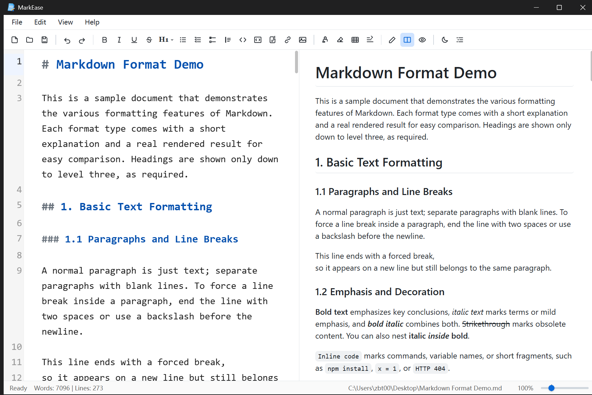
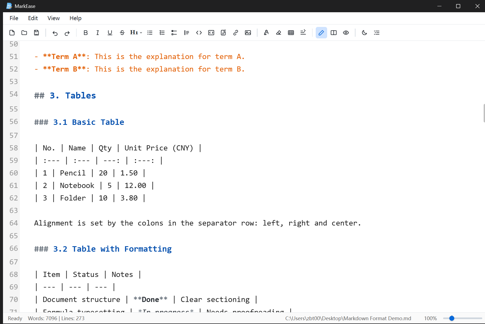
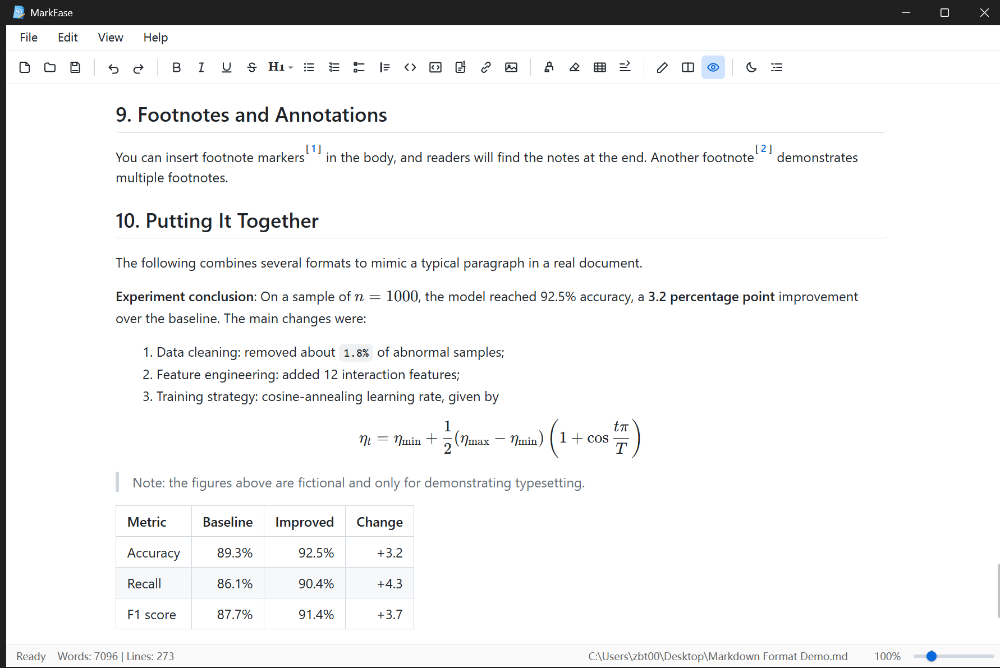
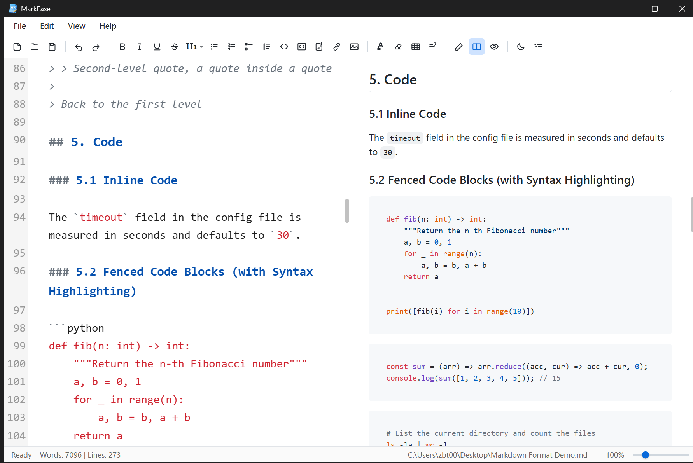
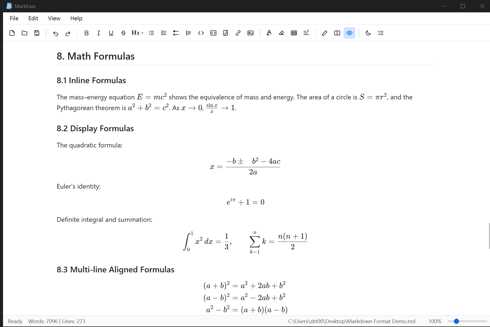
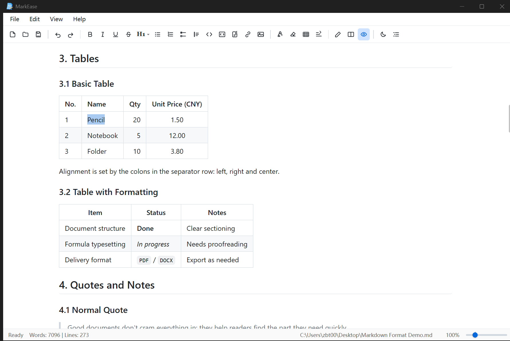
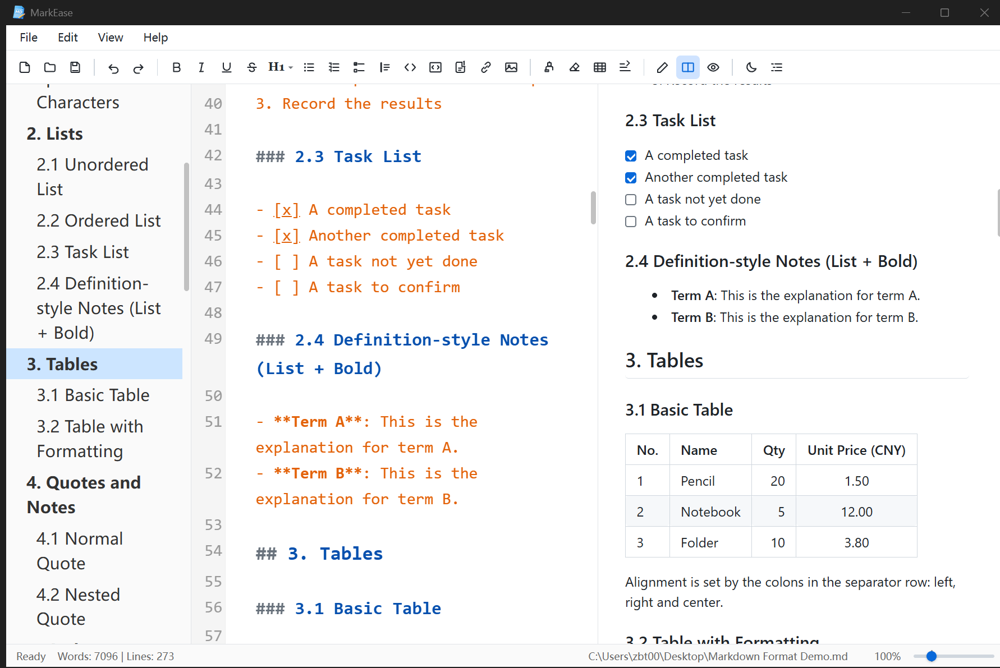
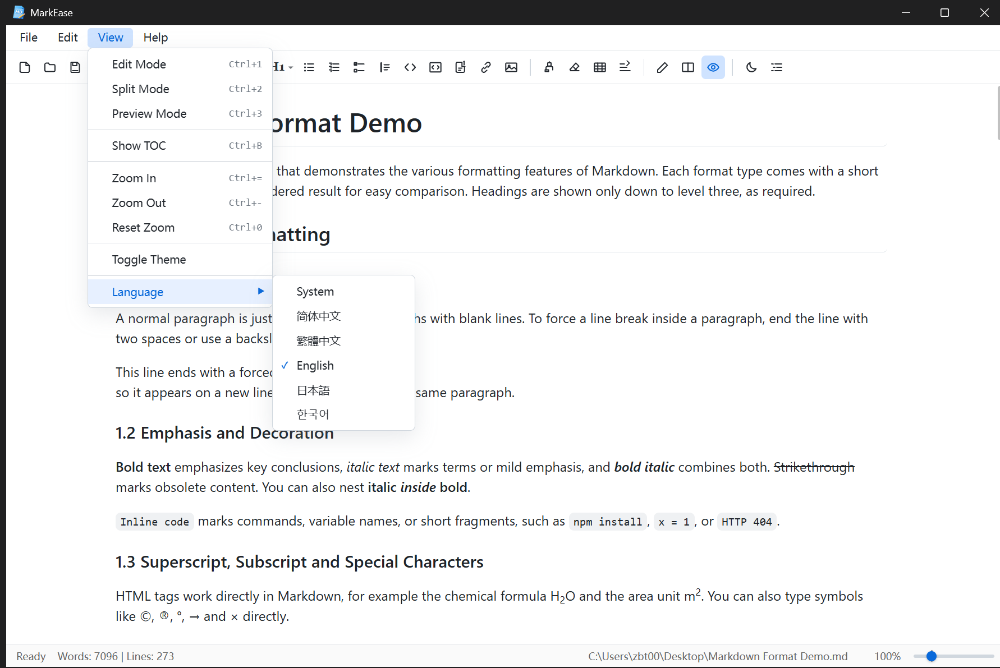

# 📝 MarkEase

> A **fully offline**, GitHub-style Markdown editor for Windows, macOS and Linux

[](https://github.com/zbt00123/MarkEase/releases) [](LICENSE) [](https://github.com/zbt00123/MarkEase/releases)

[中文](README_ZH.md) | **English** | [日本語](README_JA.md) | [한국어](README_KO.md)

> ⚠️ **Windows SmartScreen / antivirus notice**
> The release packages are **not code-signed** yet. On first launch you may see "Windows protected your PC": click "More info → Run anyway".
> MarkEase renders with WebView2, whose background networking and component updates are disabled at startup. If your antivirus flags it, add `MarkEase.exe` to your trusted list.

> ⚠️ **macOS / Linux notes**
> macOS builds ship as `.dmg` (one for Intel, one for Apple Silicon) and are **unsigned / not notarized**; on first launch right-click the app → Open, or run `xattr -dr com.apple.quarantine /Applications/MarkEase.app`.
> Linux builds ship `.deb` and `tar.gz`, and need GTK3 / WebKit2GTK; the `.deb` is recommended.
> All three platforms share one codebase; see [docs/CROSS_PLATFORM.md](docs/CROSS_PLATFORM.md) for builds.

---

## ✨ Highlights

### ⚡ Writing and Formatting

- **Three modes**: Edit / Split / Preview, switch anytime with `Ctrl+1` / `Ctrl+2` / `Ctrl+3`
- **Familiar editing**: syntax highlighting, line numbers, undo / redo, plus batch quote, list, task or code-block prefixes for selected lines
- **A full toolbar**: headings, bold, italic, underline, strikethrough, lists, tasks, quotes, inline code, code blocks, footnotes, links, images, tables and collapsible blocks
- **Format painter / eraser**: click once to paint, double-click to keep painting; the eraser clears inline formatting in one click
- **Insert link**: fetch the page title automatically, or set your own link text and favicon
- **Insert table**: pick rows and columns from a grid in the toolbar
- **Insert image**: choose a local file, drag it in, or use a URL; images are collected into an `assets/` folder next to the document
- **Nothing lost**: creating, opening or closing a document with unsaved changes asks whether to save first

### 🔢 Automatic Numbering for Ordered Lists

- Change one number and the following items renumber themselves; inserting or deleting lines keeps the sequence correct
- When automatic numbering is active you can keep it automatic or switch that list to manual numbering

### 👁️ Edit Right in the Preview

- Double-click a paragraph, a table cell or a footnote to edit it in the preview; changes are written back to the Markdown immediately
- In-progress edits are committed before switching modes, saving or searching

### 📖 Footnotes

- Insert a footnote in one click; references show as superscripts and jump to the notes at the end
- The `↩` link at the bottom returns to the reference, and `Ctrl + click [^N]` works in the editor too
- Deleting a reference in the body automatically removes its definition

### 📑 Outline and Synchronized Scrolling

- An outline is generated from headings, the current section is highlighted while you scroll, and clicking an entry moves both panes
- Drag the outline edge to resize it; `Ctrl+B` shows or hides it
- The editor and preview scroll together, even across code blocks, tables and quotes with very different line heights

### ✅ Task Lists

- Click a checkbox in the preview to toggle it, and the source updates immediately
- Select several lines and click any checkbox to toggle them together
- Copied content stays as `- [x]` / `- [ ]`, so it keeps working elsewhere

### 🔎 Find and Replace

- `Ctrl+F` opens the floating find bar; `Ctrl+H` goes straight to replace
- Case-insensitive by default, with an option for case-sensitive matching
- Fuzzy matching ignores inline markers such as `**`, `*`, `~~` and backticks
- Matches are highlighted in the preview, with a match count
- The find bar can be dragged out of the way

### 📊 Tables

- Headers and left / center / right alignment are rendered exactly as written
- Double-click a cell in the preview to edit it, including bold, italic and inline code

### 🌍 Languages and Themes

- Simplified Chinese, Traditional Chinese, English, Japanese and Korean take effect immediately, no restart
- Light, dark and follow-system themes switch both the editor and the preview

### 🎯 Zoom

- 10%–500% zoom, applied to both editor and preview
- Click the percentage in the status bar to pick a preset level, or use the slider

### 📄 PDF

- Import a PDF and get Markdown; export a high-quality vector PDF
- Long code lines wrap in both the preview and the PDF instead of being cut off
- Exported PDFs embed the original Markdown, so a re-import restores the document exactly
- Missing local images are recovered from the PDF on import

### 🌐 HTML

- Exported files inline all images, clean up dark-mode styles, and embed both the source Markdown and the outline
- Re-importing an export restores it losslessly; third-party HTML is converted to Markdown
- Broken local images are recovered from the HTML when possible

### 🖥️ System Integration

- Set MarkEase as the default program for `.md` / `.markdown`
- Right-click "New → Markdown file", double-click a file, or drag files in
- Click the file path in the status bar to reveal the file in your file manager
- When an image name already exists, compare both versions and choose replace or keep both

### 🛡️ Offline and Secure

- Runs fully offline and never collects or uploads user data
- Scripts, inline event handlers and dangerous tags are stripped when opening third-party HTML

---

## 🖼️ Screenshots

> Captured from the real MarkEase interface, using a Markdown format demo document.

| Scenario | Screenshot |
|:---:|:---:|
| Split mode |  |
| Edit mode |  |
| Preview mode |  |
| Syntax highlighting |  |
| Math formulas |  |
| Table cell editing |  |
| Task list + outline |  |
| Language switching |  |

---

## 🚀 Quick Start

### 📦 Download

1. Get the latest release from [Releases](https://github.com/zbt00123/MarkEase/releases)
2. Pick your platform:

   | Platform | File |
   |---|---|
   | Windows x64 | `MarkEase_v*_Windows_x64_portable.zip` → unzip and run `MarkEase.exe` |
   | macOS Intel | `MarkEase_v*_macOS_x64.dmg` |
   | macOS Apple Silicon | `MarkEase_v*_macOS_arm64.dmg` |
   | Linux x64 | `MarkEase_v*_Linux_x64.deb` (recommended) or `..._Linux_x64.tar.gz` |

3. On Windows, the first launch adds a "New → Markdown file" item to the context menu.
   To make MarkEase the default `.md` handler: **Help → Settings → Set as default program**.
4. On macOS, right-click → Open the first time (unsigned); on Linux, install the `.deb` and run `markease`.

### 🧑‍💻 Run from Source

```bash
git clone https://github.com/zbt00123/MarkEase.git
cd MarkEase
pip install -r requirements.txt
python main.py
```

> Python 3.11+ is recommended; Windows needs the WebView2 runtime, which is usually included in Windows 10/11.

### 🛠️ Build from Source

```bash
pip install pyinstaller
python -m PyInstaller --clean --noconfirm MarkEase.spec
```

macOS / Linux build and packaging commands are in [docs/CROSS_PLATFORM.md](docs/CROSS_PLATFORM.md).

---

## ⌨️ Keyboard Shortcuts

| Action | Shortcut |
|---|---|
| New / Open / Save / Save As | `Ctrl+N` / `Ctrl+O` / `Ctrl+S` / `Ctrl+Shift+S` |
| Undo / Redo | `Ctrl+Z` / `Ctrl+Y` |
| Edit / Split / Preview mode | `Ctrl+1` / `Ctrl+2` / `Ctrl+3` |
| Show / hide outline | `Ctrl+B` |
| Zoom in / out / reset | `Ctrl+=` / `Ctrl+-` / `Ctrl+0` |
| Insert image | `Ctrl+Shift+I` |
| Find / Replace | `Ctrl+F` / `Ctrl+H` |
| Quit | `Ctrl+Q` |
| Jump to footnote / back to reference | `Ctrl + click [^N]` |

> On macOS, `Ctrl` means `⌘` (Command); labels adapt to the platform.

---

## 🔐 Privacy

MarkEase does not collect or upload any user data, and has no telemetry or accounts. It accesses the network only when:

- you insert or open a network image — it is downloaded through the built-in `/proxy` using that image URL;
- you use "Insert link → Fetch title" — the target page title is fetched;
- every 30 days it checks GitHub Releases for updates (one HTTPS request, no personal information),
  which you can also trigger from **Help → Check for updates**; the check bypasses the system proxy to avoid VPN interference.

---

## 📄 License

This project is released under the [MIT License](LICENSE), Copyright (c) 2026 zbt00123.

- **You may**: use, copy, modify, merge, publish, distribute, sublicense and/or sell copies of this software, including for commercial projects.
- **The only requirement**: keep the above copyright notice and this license notice in all copies or substantial portions of the software.
- **Disclaimer**: the software is provided "as is", without warranty of any kind, express or implied.

Third-party components are released under their own licenses; see [THIRD_PARTY_NOTICES.md](THIRD_PARTY_NOTICES.md).

> **Note**: PDF features use **PyMuPDF**, licensed under **AGPL-3.0** (or a commercial Artifex license).
> See [THIRD_PARTY_NOTICES.md](THIRD_PARTY_NOTICES.md) for the full component list and compliance notes.

---

## 🙏 Acknowledgements

- [pywebview](https://pywebview.flowrl.com/) — lightweight Python WebView wrapper
- [CodeMirror 6](https://codemirror.net/) — modern editor core
- [marked](https://marked.js.org/) — Markdown parser
- [KaTeX](https://katex.org/) — math rendering
- [highlight.js](https://highlightjs.org/) — code highlighting
- [PyMuPDF](https://pymupdf.readthedocs.io/) — PDF parsing and generation
