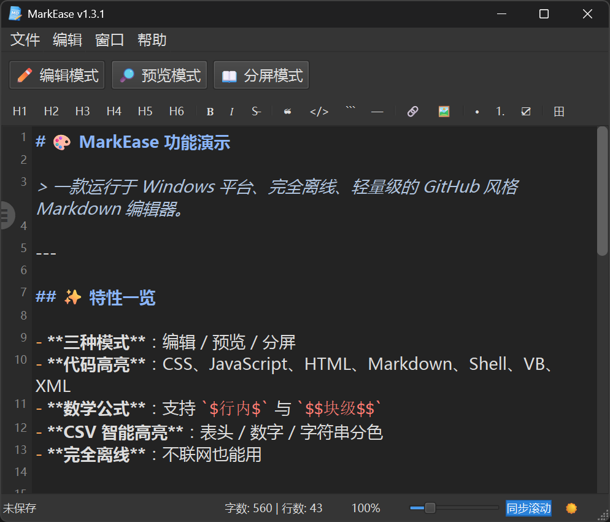
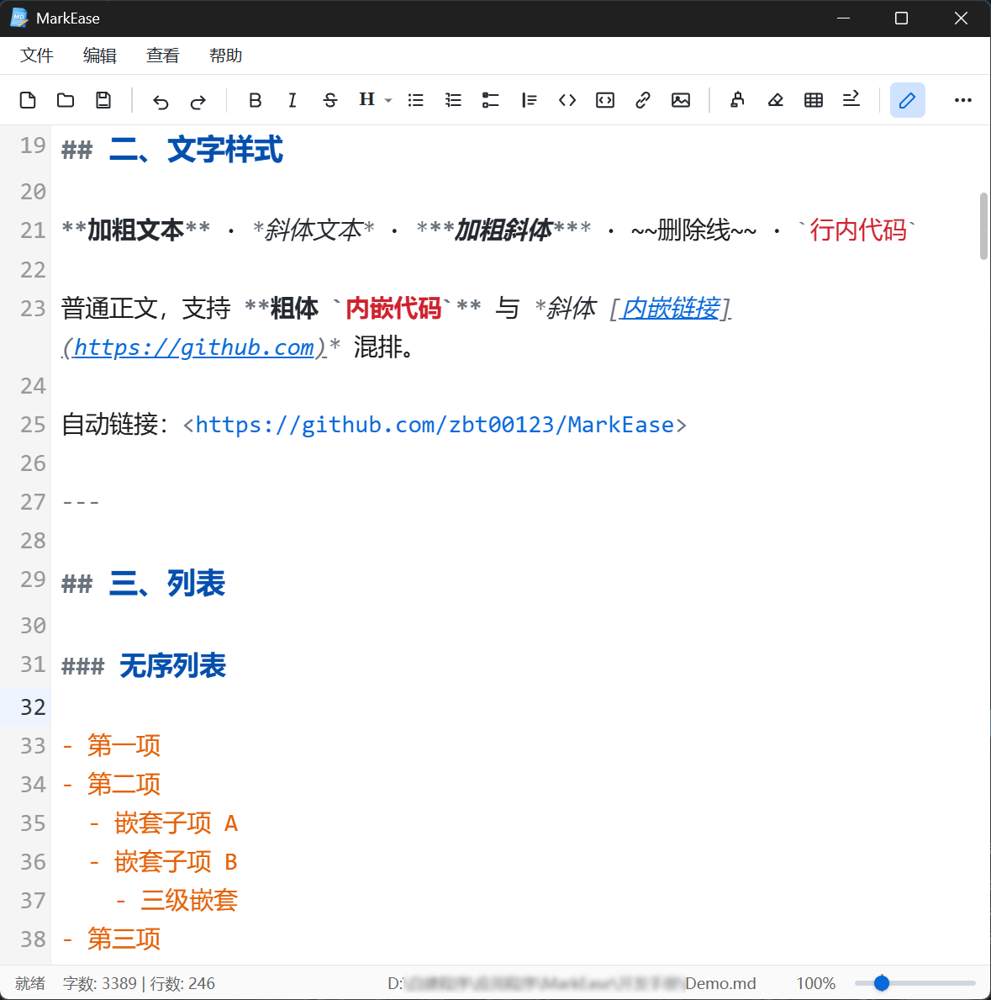
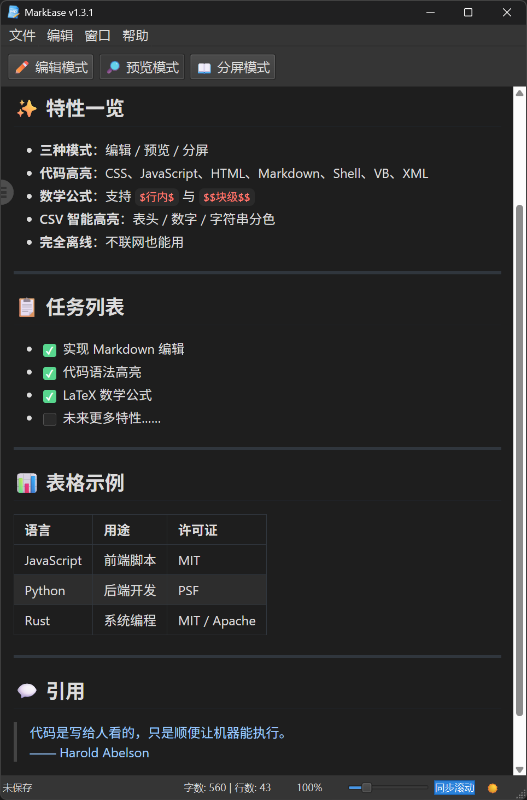
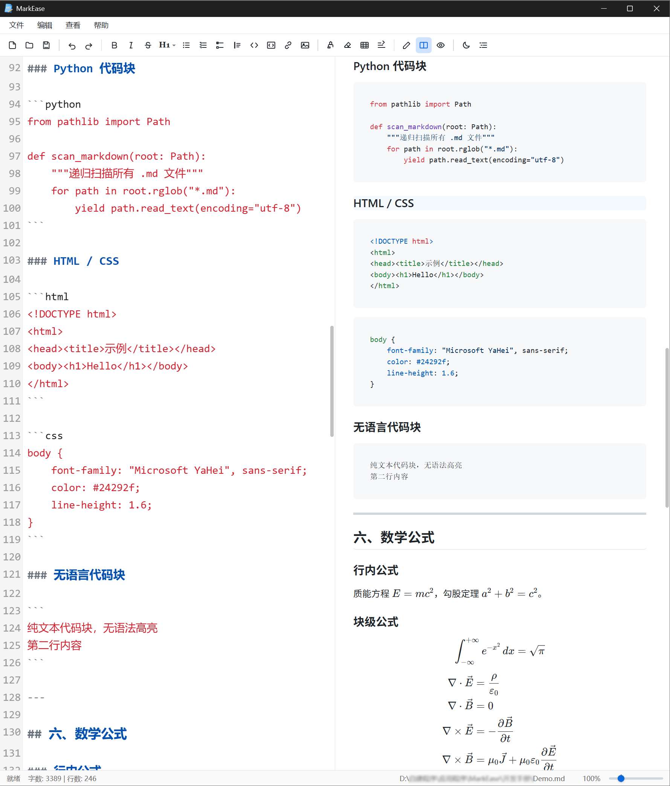
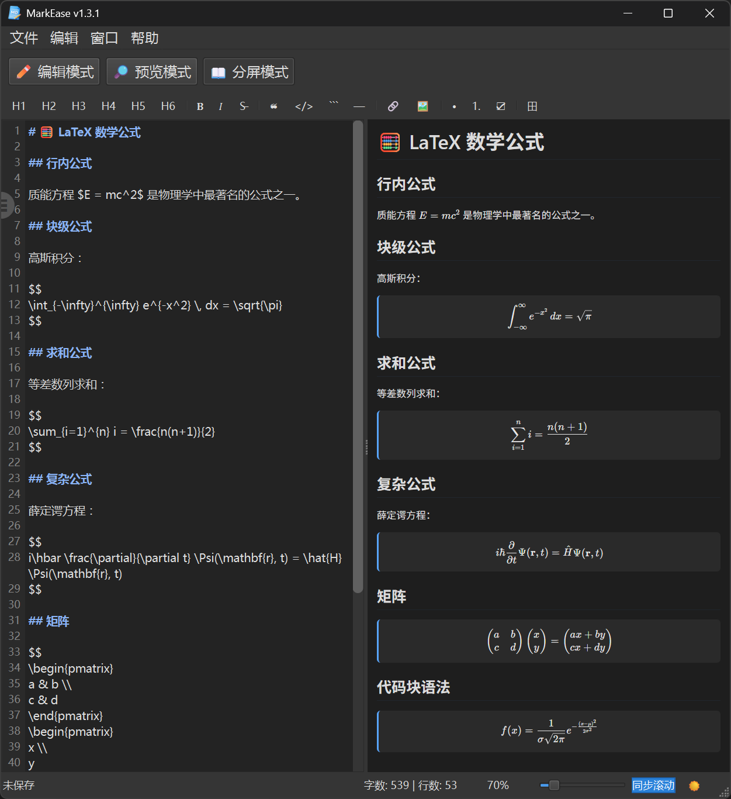
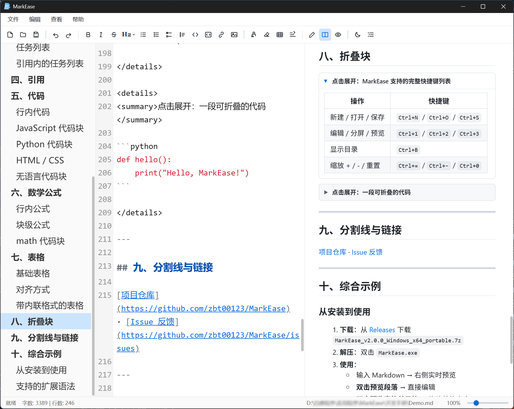
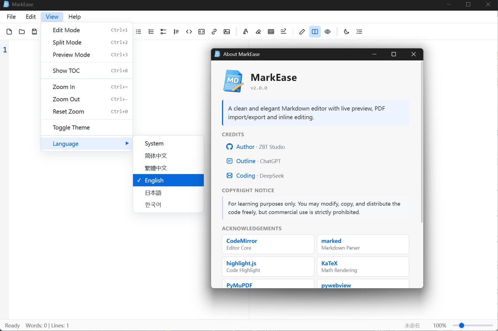

# 📝 MarkEase

> A **fully offline**, GitHub-style Markdown editor for Windows

[](https://github.com/zbt00123/MarkEase/releases) [](LICENSE) [](https://github.com/zbt00123/MarkEase/releases)

English | [中文](README_ZH.md)

> ⚠️ **Windows SmartScreen / Antivirus Warning**
> Release packages are currently **not code-signed**. On first run you may see "Windows protected your PC":
> Click "More info → Run anyway" (see "Code signing policy" below for signing application details).
> This program uses WebView2 for rendering and has disabled its background network and component updates at startup. If your antivirus flags it as a false positive, please add `MarkEase.exe` to your trust list.

---

## ✨ Highlights

### ⚡ Powerful Editing Experience

- **Three-mode switching**: Edit / Split / Preview (`Ctrl+1/2/3`)
- **CodeMirror 6 core**: Syntax highlighting, line numbers, multi-cursor, transactional undo
- **Multi-line batch operations**: Select multiple lines → add quote / list / task / code block prefix
- **Format painter**: Single-click to paint once, double-click for continuous painting
- **Eraser**: One-click removal of inline formatting
- **Collapsible blocks**: Wrap selection in `<details>`, collapse state automatically remembered
- **Insert link**: Enter URL → **automatically fetch webpage title**
- **Insert table**: Toolbar 8×8 grid for visual row/column selection
- **Insert image**: Local / drag-and-drop / URL — three methods, automatically organized into `assets/`

### 📖 Footnote Support

- **One-click insert**: Toolbar footnote button or select text → automatically generates `[^N]` reference + `[^N]: content` at document end
- **Elegant rendering**: Displayed as superscript in body text, click to jump to footnote area at bottom
- **Bidirectional navigation**: Bottom `↩` reverse link returns to reference position; `Ctrl + click` in editor also jumps
- **Automatic cleanup**: Deleting `[^N]` from body text automatically removes the corresponding `[^N]:` definition line
- **Editable in preview**: Double-click footnote content → edit directly, synced back to Markdown source in real time
- **Format painter / eraser**: When footnote reference is selected, one-click clear (including definition)

### 📑 Smart Table of Contents

- Automatically parses headings
- Current section **scroll highlighting**
- Click to jump → editor and preview **navigate simultaneously**

### 🔄 Precise Synchronized Scrolling

Based on **source position mapping algorithm**: each block records source character offsets; binary search + linear interpolation during scrolling.

Even with content having **drastically different line spacing** such as code blocks, quotes, and tables, precise alignment is maintained.

### ✅ Task List Interaction

- **Graphical checkbox** (CSS-drawn, no font dependency)
- Click in preview area → immediately syncs to source
- **Cross-line batch**: Select multiple lines + click any checkbox → toggle all
- **Copy fidelity**: Copied content remains as `- [x] / - [ ]` original text

### 📊 Table Editing

- Toolbar grid for row/column selection → quick insertion of standard GFM tables
- **Double-click cells** in preview area for direct editing, synced back to Markdown in real time

### 🖱️ Context Menu (Multi-language) ★ New in v2.1.0

- **Editor area**: Undo / Redo / Cut / Copy / Paste / Select All / Find
- **Preview area**: Copy (when selected) / Select All / Find
- **Fully follows theme** (Light / Dark) and **interface language** (Chinese / Traditional Chinese / English / Japanese / Korean)
- **Smart avoidance**: Automatically flips inward when near window edges

### 🌍 Multi-language

- Simplified Chinese / Traditional Chinese / English / Japanese / Korean
- Covers menus, toolbar, dialogs, context menus, footnote buttons, status bar hints

### 🔔 Check for Updates

- **Manual**: Help → Check for Updates
- **Silent**: Automatic update check every 30 days
- **Bypasses system proxy** during checks to avoid VPN interference

### 🎯 Zoom & Layout

- **10% – 500%** zoom, editor / preview synchronized
- Status bar slider supports **snap-to-click** (90%–110% → 100%)
- Click percentage → **preset menu** (50 / 75 / 100 / ... / 500)

### 📄 PDF Round-trip

- **Import**: PyMuPDF parsing → automatic Markdown conversion
- **Export**: High-definition vector PDF
- **Source embedding**: Original Markdown embedded in PDF (`markease_source.md`) → **lossless round-trip**
- **Image recovery**: If locally referenced images in Markdown are missing during import, automatically extract from PDF in order, write to system temp directory, and migrate to `assets/` on save

### 🌐 HTML Lossless Round-trip

- **Export**: Inline all images, clean dark mode CSS, embed source Markdown and document TOC
- **Import**: Prioritizes reading embedded source → 100% restoration; third-party HTML automatically converted via DOM
- **Image recovery**: For MarkEase-exported HTML, if locally referenced images in meta are no longer valid, automatically recover from base64 data in the visual layer

### 🖥️ System Integration

- **Set as default program**: Help → Settings → Associate `.md` / `.markdown` (writes to HKCU, no admin required)
- **Right-click "New" menu**: Desktop right-click → New → "Markdown File"
- **File location**: Click status bar path → open in Explorer with file selected
- **Drag-and-drop import**: Drag images / PDF / HTML / Markdown → automatically recognized and processed
- **Image conflicts**: Same-name file comparison dialog (thumbnail + size), supports replace / keep both
- **Double-click to open**: Double-click `.md` / `.markdown` / `.pdf` to open directly with MarkEase

### 🛡️ Security & Privacy

- **Dual-layer XSS defense**: HTML escaping + DOM whitelist
- **Blocks dangerous tags**: `<script>` / `<iframe>` / `<svg>` etc. all removed
- **Disables inline events**: `onerror` / `onclick` and other attributes all stripped
- **URL protocol whitelist**: `http / https / mailto / tel / file` etc.
- **KaTeX safe allowance**: `style` attribute allowed only within formula subtree, and values must pass security sanitization
- **Fully offline**: All resources bundled locally

---

## 🖼️ Interface Preview

| Scenario | Screenshot |
|:---:|:---:|
| Split mode |  |
| Edit mode |  |
| Preview mode |  |
| Code highlighting + Math formulas |  |
| Table cell editing |  |
| Task list + Table of contents |  |
| Multi-language switching |  |

---

## 🚀 Quick Start

### 📦 Download & Use

1. Go to [Releases](https://github.com/zbt00123/MarkEase/releases) to download
2. Extract the release package (`.7z` / `.zip`, refer to actual files on the Releases page)
3. Double-click `MarkEase.exe`

> On first launch, the right-click "New → Markdown File" item is automatically added.
> To set as default `.md` program: **Help → Settings → Set as default program**.

### 🧑‍💻 Run from Source

```bash
git clone https://github.com/zbt00123/MarkEase.git
cd MarkEase
pip install -r requirements.txt
python main.py
```

---

## ⌨️ Keyboard Shortcuts

| Function | Shortcut |
|---|---|
| New / Open / Save / Save As | `Ctrl+N` / `Ctrl+O` / `Ctrl+S` / `Ctrl+Shift+S` |
| Undo / Redo | `Ctrl+Z` / `Ctrl+Y` |
| Edit / Split / Preview mode | `Ctrl+1` / `Ctrl+2` / `Ctrl+3` |
| Show/Hide TOC | `Ctrl+B` |
| Zoom in / Zoom out / Reset zoom | `Ctrl+=` / `Ctrl+-` / `Ctrl+0` |
| Insert image | `Ctrl+Shift+I` |
| Find / Replace | `Ctrl+F` / `Ctrl+H` |
| **Jump to footnote definition / Back to reference** | **`Ctrl + click [^N]`** |

---

## 🔏 Code signing policy

Free code signing provided by [SignPath.io](https://about.signpath.io), certificate by [SignPath Foundation](https://signpath.org).

- Committers and reviewers: [@zbt00123](https://github.com/zbt00123)
- Approvers: [@zbt00123](https://github.com/zbt00123)
- Privacy: MarkEase does not collect or upload any user data. Network access occurs only when you actively perform an action or during program self-checks:
  - When you actively insert / open a network image, it is downloaded via the built-in `/proxy` using that image URL;
  - When you actively "Insert Link," the target webpage title is fetched;
  - Every 30 days, a check for updates is made to GitHub Releases (a single HTTPS request, containing no personal information),
    which can also be manually triggered via "Help → Check for Updates."

---

## 📄 License

This project is released under the [MIT License](LICENSE), Copyright (c) 2026 zbt00123.

- **You may**: Freely use, copy, modify, merge, publish, distribute, sublicense, and/or sell copies of this software,
  including for commercial projects.
- **Only requirement**: Retain the above copyright notice and this license notice in all copies or substantial portions of the software.
- **Disclaimer**: This software is provided "as is," without warranty of any kind, express or implied.

Third-party components are released under their respective licenses; see [THIRD_PARTY_NOTICES.md](THIRD_PARTY_NOTICES.md) for details.

---

## 🙏 Acknowledgements

- [pywebview](https://pywebview.flowrl.com/) — Lightweight Python WebView wrapper
- [CodeMirror 6](https://codemirror.net/) — Modern editor core
- [marked](https://marked.js.org/) — Markdown parser
- [KaTeX](https://katex.org/) — Math formula rendering
- [highlight.js](https://highlightjs.org/) — Code highlighting
- [PyMuPDF](https://pymupdf.readthedocs.io/) — PDF parsing and generation