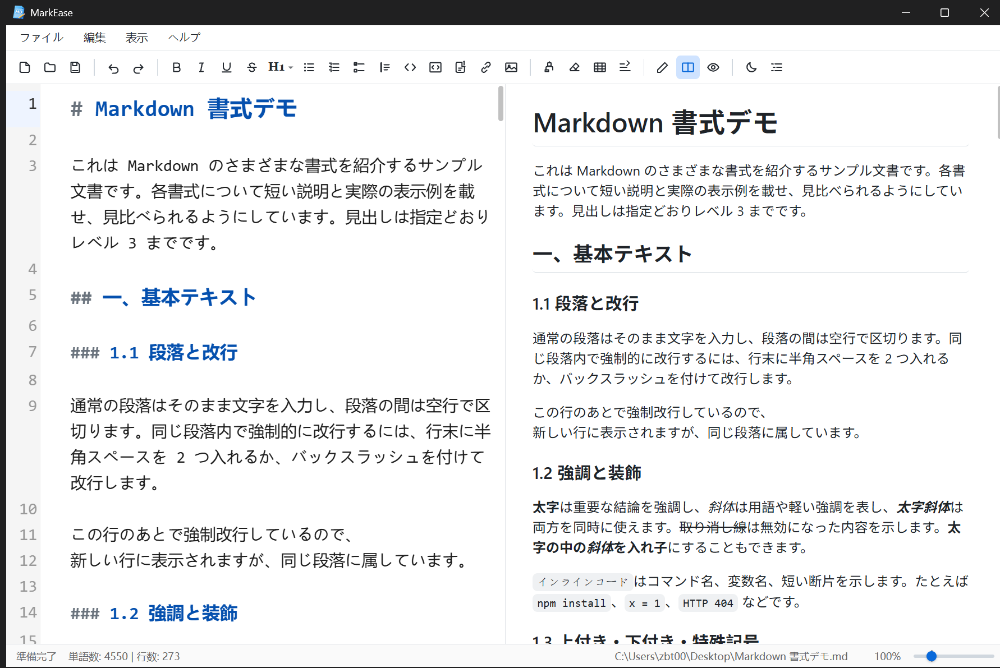
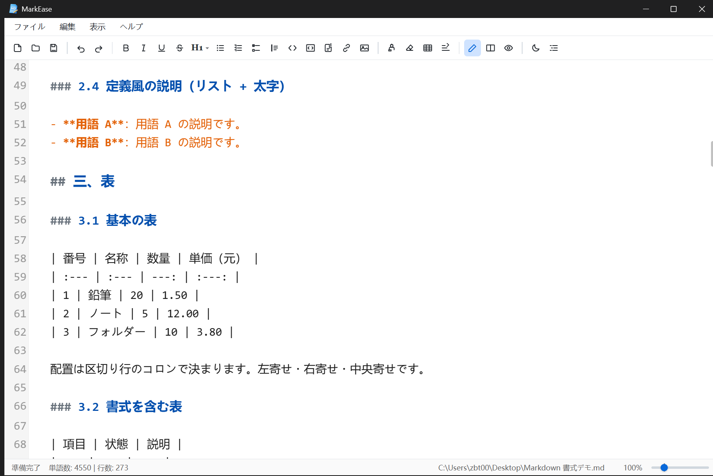
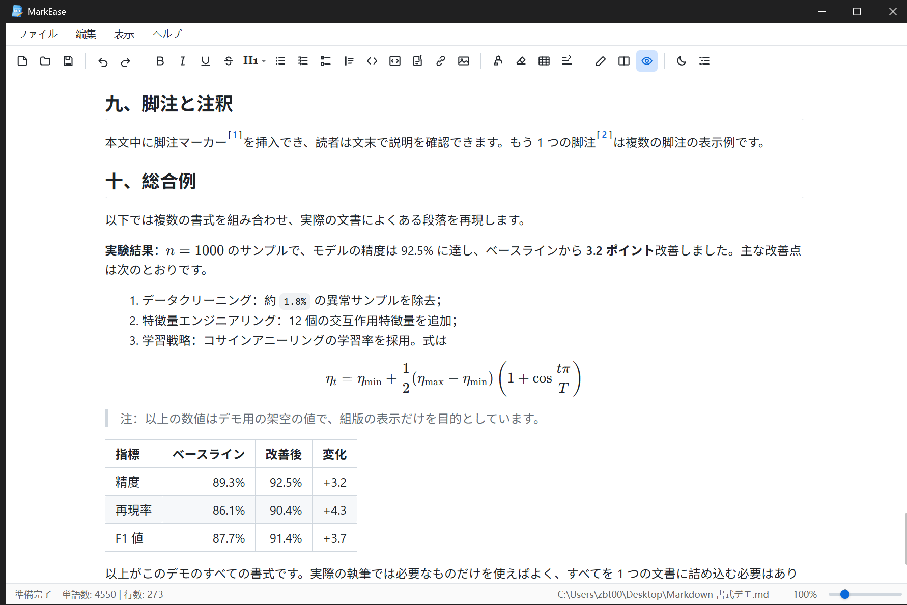
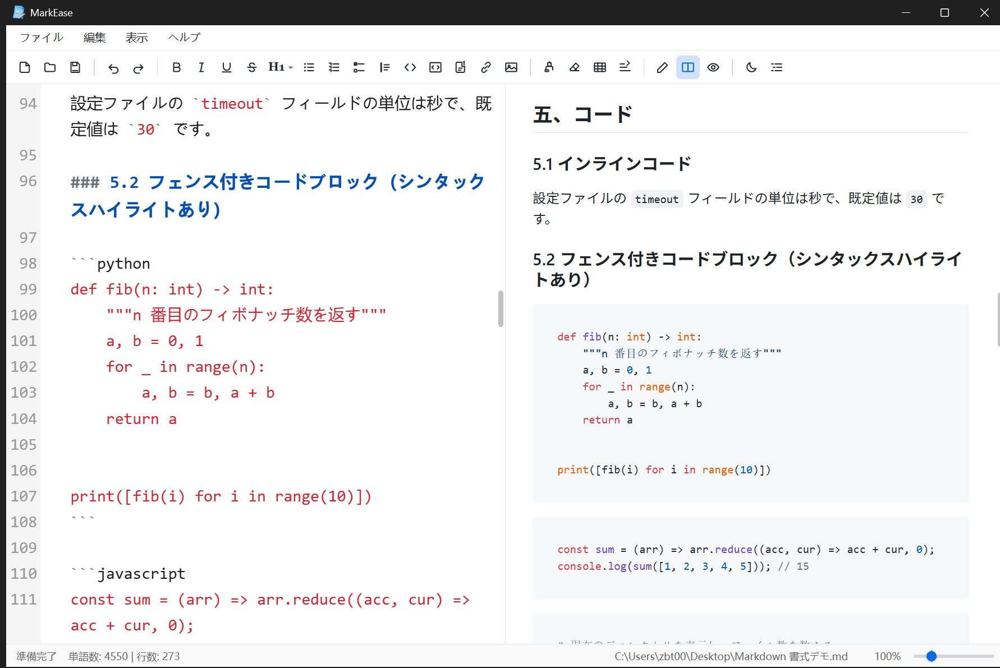
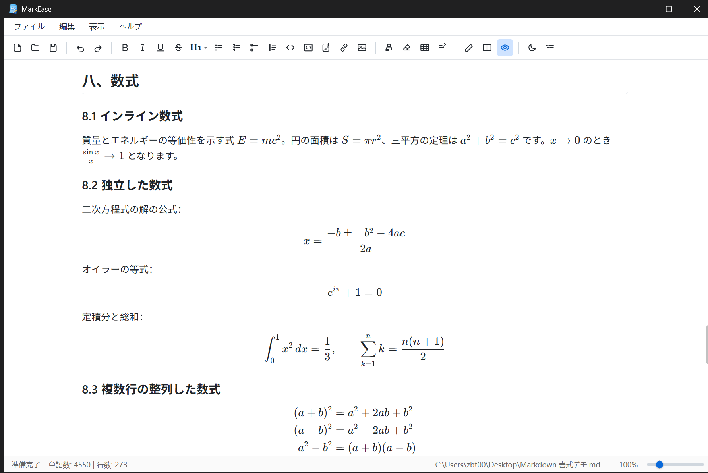
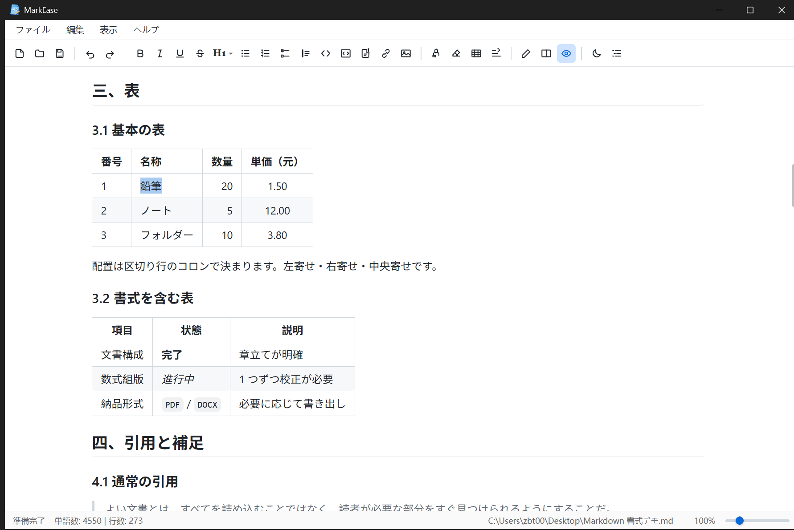
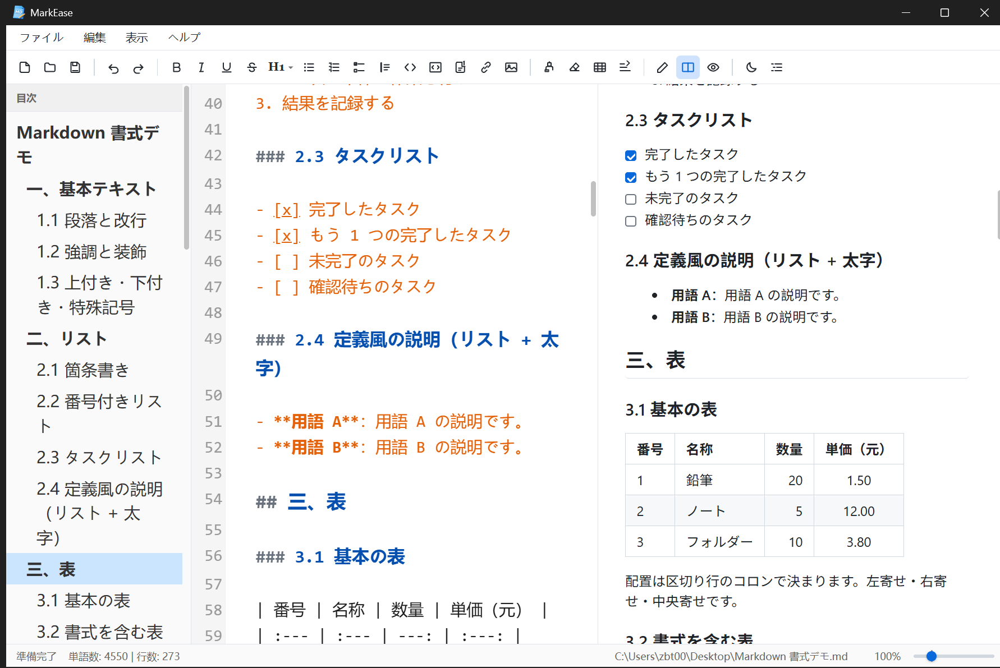
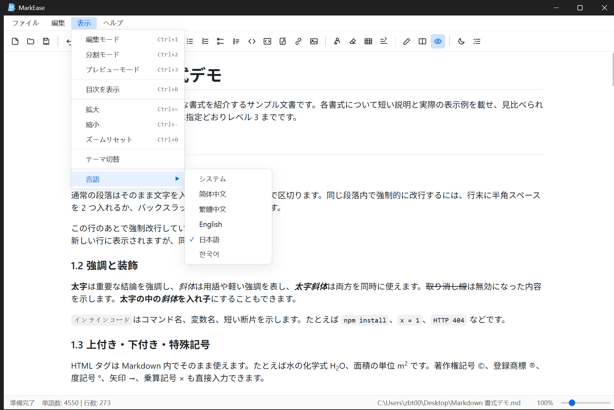

# 📝 MarkEase

> Windows / macOS / Linux で動作する、**完全オフライン**の GitHub 風 Markdown エディター

[](https://github.com/zbt00123/MarkEase/releases) [](LICENSE) [](https://github.com/zbt00123/MarkEase/releases)

[中文](README_ZH.md) | [English](README.md) | **日本語** | [한국어](README_KO.md)

> ⚠️ **Windows SmartScreen / ウイルス対策ソフトの警告**
> 配布パッケージはまだ**コード署名されていません**。初回起動時に「Windows によって PC が保護されました」と表示された場合は、「詳細情報 → 実行」をクリックしてください。
> 本アプリは WebView2 で描画しており、起動時にバックグラウンド通信とコンポーネント更新を無効化しています。ウイルス対策ソフトが誤検知する場合は `MarkEase.exe` を信頼リストに追加してください。

> ⚠️ **macOS / Linux について**
> macOS 版は `.dmg`（Intel / Apple Silicon 各 1 つ）で、**署名・公証は未対応**です。初回起動時はアプリを右クリック →「開く」を選ぶか、`xattr -dr com.apple.quarantine /Applications/MarkEase.app` を実行してください。
> Linux 版は `.deb` と `tar.gz` を用意しており、GTK3 / WebKit2GTK が必要です。`.deb` のインストールを推奨します。
> 3 プラットフォームは同じコードベースを共有しています。ビルド方法は [docs/CROSS_PLATFORM.md](docs/CROSS_PLATFORM.md) を参照してください。

---

## ✨ 主な機能

### ⚡ 執筆と整形

- **3 つのモード**：編集 / 分割 / プレビュー。`Ctrl+1` / `Ctrl+2` / `Ctrl+3` でいつでも切り替え
- **見慣れた編集体験**：シンタックスハイライト、行番号、元に戻す / やり直し。複数行を選んで引用・リスト・タスク・コードブロックをまとめて付けられます
- **充実したツールバー**：見出し、太字、斜体、下線、取り消し線、リスト、タスク、引用、インラインコード、コードブロック、脚注、リンク、画像、表、折りたたみブロック
- **書式コピー / 書式クリア**：1 回クリックで 1 回適用、ダブルクリックで連続適用。書式クリアはインライン書式をまとめて解除します
- **リンク挿入**：URL を入れるとページタイトルを自動取得。リンク文字やサイトアイコンも指定できます
- **表の挿入**：ツールバーのグリッドから行と列を選んで作成
- **画像の挿入**：ローカルファイル、ドラッグ＆ドロップ、URL の 3 通り。画像は文書と同じ階層の `assets/` にまとめられます
- **未保存の確認**：未保存の変更がある状態で新規作成・開く・閉じるを行うと、保存するか確認します

### 🔢 番号付きリストの自動採番

- 1 つの番号を変えると、後続の同じ階層の項目が自動で振り直されます。行の挿入・削除でも番号が保たれます
- 自動採番が有効なときは、そのまま自動を続けるか、手動番号に切り替えるかを選べます

### 👁️ プレビュー上で直接編集

- 段落、表のセル、脚注をダブルクリックするとプレビュー上でそのまま編集でき、変更はすぐ Markdown に反映されます
- モード切り替え、保存、検索の前には編集中の内容が自動的に確定されます

### 📖 脚注

- ワンクリックで脚注を挿入。本文では上付きで表示され、クリックすると文末の脚注へ移動します
- 文末の `↩` で引用位置に戻れ、エディター内でも `Ctrl + クリック [^N]` が使えます
- 本文中の脚注参照を削除すると、対応する定義行も自動的に削除されます

### 📑 目次と同期スクロール

- 見出しから目次を自動生成し、スクロール中は現在の章をハイライト。項目をクリックすると編集側とプレビュー側が同時に移動します
- 目次の幅はドラッグで調整でき、`Ctrl+B` で表示 / 非表示を切り替え
- コードブロック、表、引用など行の高さが大きく異なる内容でも、編集側とプレビュー側は同期してスクロールします

### ✅ タスクリスト

- プレビューのチェックボックスをクリックすると、ソースの `[ ]` / `[x]` がすぐ更新されます
- 複数行を選んでチェックボックスをクリックすると、まとめて切り替えられます
- コピーした内容は `- [x]` / `- [ ]` のままなので、別の場所に貼り付けても使えます

### 🔎 検索と置換

- `Ctrl+F` で検索バーを開き、`Ctrl+H` で置換に直接移動
- 既定では大文字と小文字を区別せず、区別する設定にも切り替え可能
- `**`、`*`、`~~`、バッククォートなどのインライン記号を無視するあいまい検索に対応
- プレビュー上でも一致箇所をハイライトし、件数を表示
- 検索バーはドラッグで邪魔にならない位置に移動できます

### 📊 表

- ヘッダーと左 / 中央 / 右の配置を、書いたとおりに表示
- プレビュー上でセルをダブルクリックして編集でき、太字・斜体・インラインコードにも対応

### 🌍 言語とテーマ

- 簡体字中国語 / 繁体字中国語 / English / 日本語 / 한국어 を、再起動なしですぐに切り替え
- ライト / ダーク / システム連動の 3 テーマ。編集側とプレビュー側が同時に切り替わります

### 🎯 ズーム

- 10%〜500% のズーム。編集側とプレビュー側に同時に適用
- ステータスバーのパーセントをクリックしてプリセットを選択、またはスライダーで調整

### 📄 PDF

- PDF を読み込むと Markdown に変換し、高品質なベクター PDF として書き出せます
- コードブロックの長い行はプレビューでも PDF でも折り返され、切れません
- 書き出した PDF には元の Markdown が埋め込まれ、再読み込みで元どおりに復元できます
- 読み込み時に見つからないローカル画像は、PDF から自動で復元します

### 🌐 HTML

- 書き出し時に画像をインライン化し、ダークモード用スタイルを整理して、元の Markdown と目次を埋め込みます
- 書き出したファイルを再読み込みすると無劣化で復元。第三者の HTML も Markdown に変換できます
- ローカル画像が無効な場合は HTML から復元を試みます

### 🖥️ システム連携

- `.md` / `.markdown` の既定のプログラムに設定可能
- 右クリック「新規作成 → Markdown ファイル」、ダブルクリックでの起動、ドラッグ＆ドロップでの読み込みに対応
- ステータスバーのファイルパスをクリックすると、ファイルマネージャーでその場所を開きます
- 画像名が重複した場合は、両方を比較して「置き換え」か「両方保持」を選択

### 🛡️ オフラインと安全性

- 完全オフラインで動作し、ユーザーデータの収集や送信は行いません
- 第三者の HTML を開くときは、スクリプト、インラインイベント、危険なタグを自動的に除去します

---

## 🖼️ スクリーンショット

> 実際の MarkEase 画面から取得したものです。Markdown 書式デモ文書を使用しています。

| シーン | スクリーンショット |
|:---:|:---:|
| 分割モード |  |
| 編集モード |  |
| プレビューモード |  |
| シンタックスハイライト |  |
| 数式 |  |
| 表のセル編集 |  |
| タスクリスト + 目次 |  |
| 言語の切り替え |  |

---

## 🚀 はじめかた

### 📦 ダウンロード

1. [Releases](https://github.com/zbt00123/MarkEase/releases) から最新版を取得
2. プラットフォームに合わせて選択：

   | プラットフォーム | ファイル |
   |---|---|
   | Windows x64 | `MarkEase_v*_Windows_x64_portable.zip` → 解凍して `MarkEase.exe` を実行 |
   | macOS Intel | `MarkEase_v*_macOS_x64.dmg` |
   | macOS Apple Silicon | `MarkEase_v*_macOS_arm64.dmg` |
   | Linux x64 | `MarkEase_v*_Linux_x64.deb`（推奨）または `..._Linux_x64.tar.gz` |

3. Windows では初回起動時に、右クリック「新規作成 → Markdown ファイル」が追加されます。
   `.md` の既定のプログラムにするには：**ヘルプ → 設定 → 既定のプログラムに設定**。
4. macOS は初回のみ右クリック →「開く」（未署名）。Linux は `.deb` をインストールして `markease` を実行します。

### 🧑‍💻 ソースから実行

```bash
git clone https://github.com/zbt00123/MarkEase.git
cd MarkEase
pip install -r requirements.txt
python main.py
```

> Python 3.11 以上を推奨します。Windows では WebView2 ランタイムが必要です（Windows 10/11 には通常含まれています）。

### 🛠️ ソースからビルド

```bash
pip install pyinstaller
python -m PyInstaller --clean --noconfirm MarkEase.spec
```

macOS / Linux のビルドとパッケージング手順は [docs/CROSS_PLATFORM.md](docs/CROSS_PLATFORM.md) を参照してください。

---

## ⌨️ ショートカット一覧

| 操作 | ショートカット |
|---|---|
| 新規 / 開く / 保存 / 名前を付けて保存 | `Ctrl+N` / `Ctrl+O` / `Ctrl+S` / `Ctrl+Shift+S` |
| 元に戻す / やり直し | `Ctrl+Z` / `Ctrl+Y` |
| 編集 / 分割 / プレビューモード | `Ctrl+1` / `Ctrl+2` / `Ctrl+3` |
| 目次の表示 / 非表示 | `Ctrl+B` |
| 拡大 / 縮小 / ズームリセット | `Ctrl+=` / `Ctrl+-` / `Ctrl+0` |
| 画像を挿入 | `Ctrl+Shift+I` |
| 検索 / 置換 | `Ctrl+F` / `Ctrl+H` |
| 終了 | `Ctrl+Q` |
| 脚注定義へ / 引用位置へ戻る | `Ctrl + クリック [^N]` |

> macOS では `Ctrl` は `⌘`（Command）に対応します。表示はプラットフォームに合わせて自動的に切り替わります。

---

## 🔐 プライバシー

MarkEase はユーザーデータを収集・送信せず、テレメトリーやアカウントもありません。ネットワークにアクセスするのは次の場合だけです：

- ネットワーク画像を挿入 / 開いたとき — その画像 URL を使って内蔵の `/proxy` からダウンロードします；
- 「リンク挿入 → タイトルを取得」を使ったとき — 対象ページのタイトルを取得します；
- 30 日ごとに GitHub Releases へ更新を確認するとき（HTTPS リクエスト 1 回のみ、個人情報は含みません）。
  **ヘルプ → 更新を確認** から手動で実行することもできます。確認時は VPN の影響を避けるためシステムプロキシを迂回します。

---

## 📄 ライセンス

本プロジェクトは [MIT License](LICENSE) で公開されています。Copyright (c) 2026 zbt00123.

- **できること**：本ソフトウェアを使用、コピー、変更、結合、公開、配布、再許諾、販売できます。商用プロジェクトでも利用可能です。
- **唯一の条件**：ソフトウェアのすべての複製または重要な部分に、上記の著作権表示と本ライセンス表示を残してください。
- **免責**：本ソフトウェアは「現状のまま」提供され、明示・黙示を問わずいかなる保証も伴いません。

第三者コンポーネントはそれぞれのライセンスで公開されています。詳細は [THIRD_PARTY_NOTICES.md](THIRD_PARTY_NOTICES.md) を参照してください。

> **注意**：PDF 機能は **PyMuPDF**（**AGPL-3.0** または Artifex の商用ライセンス）を使用しています。
> コンポーネント一覧とコンプライアンスについては [THIRD_PARTY_NOTICES.md](THIRD_PARTY_NOTICES.md) を参照してください。

---

## 🙏 謝辞

- [pywebview](https://pywebview.flowrl.com/) — 軽量な Python WebView ラッパー
- [CodeMirror 6](https://codemirror.net/) — モダンなエディターコア
- [marked](https://marked.js.org/) — Markdown パーサー
- [KaTeX](https://katex.org/) — 数式レンダリング
- [highlight.js](https://highlightjs.org/) — コードハイライト
- [PyMuPDF](https://pymupdf.readthedocs.io/) — PDF の解析と生成
