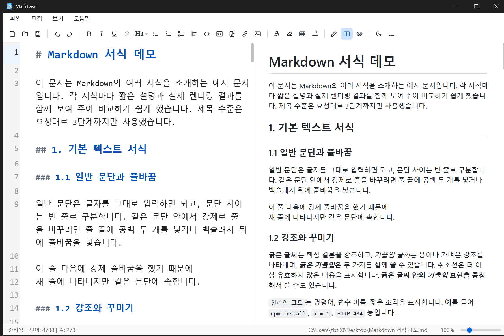
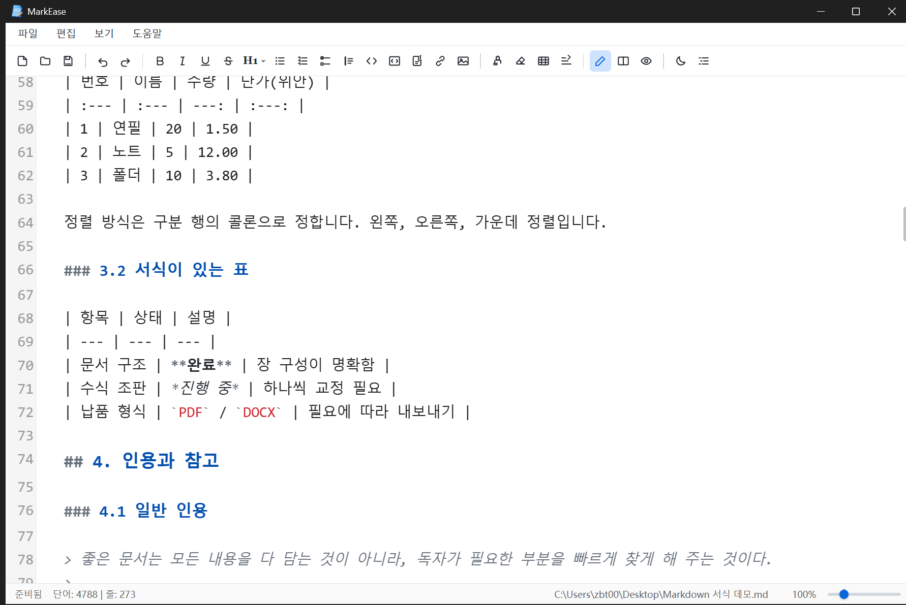
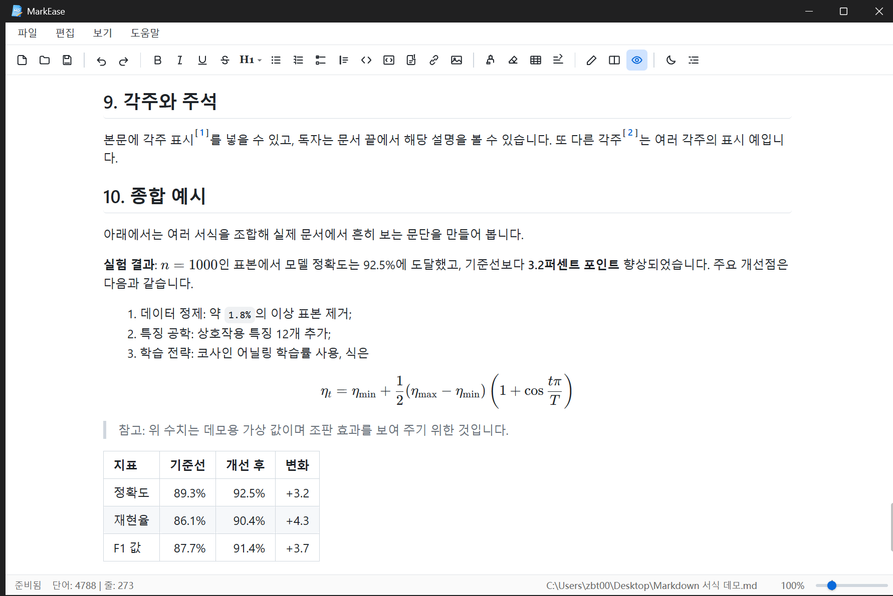
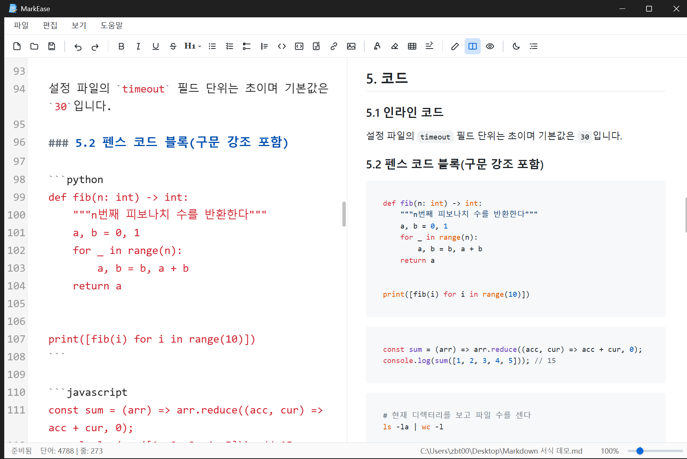
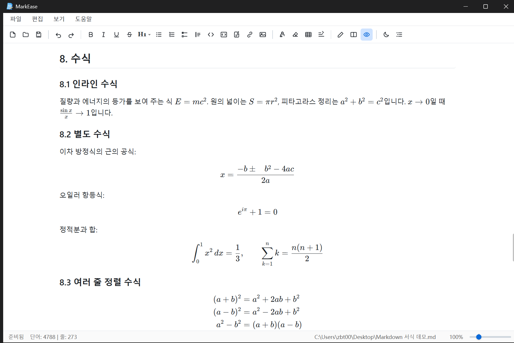
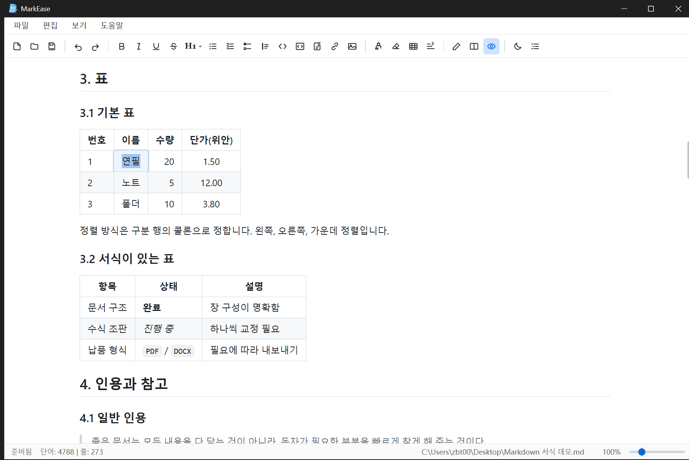
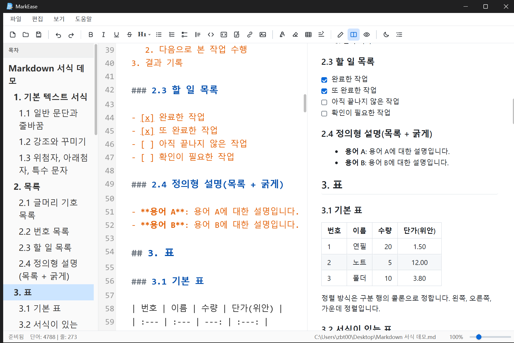
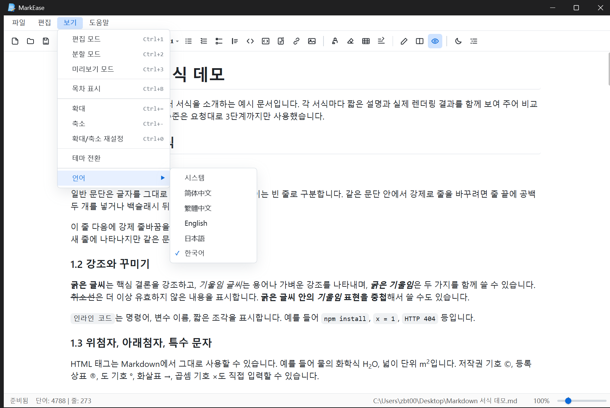

# 📝 MarkEase

> Windows / macOS / Linux에서 동작하는 **완전 오프라인** GitHub 스타일 Markdown 편집기

[](https://github.com/zbt00123/MarkEase/releases) [](LICENSE) [](https://github.com/zbt00123/MarkEase/releases)

[中文](README_ZH.md) | [English](README.md) | [日本語](README_JA.md) | **한국어**

> ⚠️ **Windows SmartScreen / 백신 경고**
> 배포 패키지는 아직 **코드 서명이 되어 있지 않습니다**. 처음 실행할 때 "Windows에서 PC를 보호했습니다"가 표시되면 "추가 정보 → 실행"을 클릭하세요.
> 이 앱은 WebView2로 렌더링하며, 시작할 때 백그라운드 네트워크와 구성 요소 업데이트를 비활성화합니다. 백신이 오탐하는 경우 `MarkEase.exe`를 신뢰 목록에 추가하세요.

> ⚠️ **macOS / Linux 안내**
> macOS 버전은 `.dmg`(Intel / Apple Silicon 각 1개)이며 **서명 및 공증이 되어 있지 않습니다**. 처음 실행할 때 앱을 마우스 오른쪽 버튼으로 클릭 → "열기"를 선택하거나 `xattr -dr com.apple.quarantine /Applications/MarkEase.app`를 실행하세요.
> Linux 버전은 `.deb`와 `tar.gz`를 제공하며 GTK3 / WebKit2GTK가 필요합니다. `.deb` 설치를 권장합니다.
> 세 플랫폼은 동일한 코드베이스를 공유합니다. 빌드 방법은 [docs/CROSS_PLATFORM.md](docs/CROSS_PLATFORM.md)를 참고하세요.

---

## ✨ 주요 기능

### ⚡ 작성과 서식

- **세 가지 모드**: 편집 / 분할 / 미리보기, `Ctrl+1` / `Ctrl+2` / `Ctrl+3`으로 언제든 전환
- **익숙한 편집 환경**: 구문 강조, 줄 번호, 실행 취소 / 다시 실행. 여러 줄을 선택해 인용, 목록, 할 일, 코드 블록 접두사를 한 번에 적용할 수 있습니다
- **풍부한 도구 모음**: 제목, 굵게, 기울임, 밑줄, 취소선, 목록, 할 일, 인용, 인라인 코드, 코드 블록, 각주, 링크, 이미지, 표, 접기 블록
- **서식 복사 / 서식 지우기**: 한 번 클릭하면 한 번 적용, 두 번 클릭하면 연속 적용. 서식 지우기는 인라인 서식을 한 번에 지웁니다
- **링크 삽입**: URL을 입력하면 페이지 제목을 자동으로 가져오고, 링크 텍스트와 사이트 아이콘도 지정할 수 있습니다
- **표 삽입**: 도구 모음의 그리드에서 행과 열을 선택해 생성
- **이미지 삽입**: 로컬 파일, 끌어다 놓기, URL 세 가지 방식. 이미지는 문서와 같은 위치의 `assets/` 폴더에 모입니다
- **저장 확인**: 저장하지 않은 변경이 있는 상태에서 새로 만들기, 열기, 닫기를 하면 먼저 저장할지 묻습니다

### 🔢 번호 목록 자동 번호 매기기

- 한 항목의 번호를 바꾸면 같은 수준의 뒤 항목 번호가 자동으로 이어집니다. 줄을 넣거나 지워도 번호가 유지됩니다
- 자동 번호가 켜져 있을 때 그대로 자동을 유지하거나 해당 목록만 수동 번호로 바꿀 수 있습니다

### 👁️ 미리보기에서 바로 편집

- 문단, 표 셀, 각주를 두 번 클릭하면 미리보기에서 바로 편집할 수 있고 변경 내용은 즉시 Markdown에 반영됩니다
- 모드 전환, 저장, 찾기 전에 편집 중인 내용이 자동으로 확정됩니다

### 📖 각주

- 클릭 한 번으로 각주를 삽입하며, 본문에서는 위첨자로 표시되고 클릭하면 문서 끝의 각주로 이동합니다
- 문서 끝의 `↩`로 인용 위치로 돌아갈 수 있고, 편집기에서도 `Ctrl + 클릭 [^N]`이 동작합니다
- 본문의 각주 참조를 지우면 해당 정의 줄도 자동으로 정리됩니다

### 📑 목차와 동기 스크롤

- 제목에서 목차를 자동으로 만들고, 스크롤하는 동안 현재 장을 강조하며, 항목을 클릭하면 편집 영역과 미리보기가 함께 이동합니다
- 목차 너비는 끌어서 조절할 수 있고 `Ctrl+B`로 표시 / 숨김을 전환합니다
- 코드 블록, 표, 인용처럼 줄 높이 차이가 큰 내용에서도 편집 영역과 미리보기가 함께 스크롤됩니다

### ✅ 작업 목록

- 미리보기의 체크박스를 클릭하면 소스의 `[ ]` / `[x]`가 즉시 바뀝니다
- 여러 줄을 선택한 뒤 아무 체크박스나 클릭하면 한꺼번에 전환됩니다
- 복사한 내용은 `- [x]` / `- [ ]` 형태로 유지되어 다른 곳에 붙여도 그대로 동작합니다

### 🔎 찾기 및 바꾸기

- `Ctrl+F`로 찾기 막대를 열고, `Ctrl+H`로 바로 바꾸기로 이동합니다
- 기본은 대소문자 무시이며, 대소문자 구분으로 바꿀 수 있습니다
- `**`, `*`, `~~`, 백틱 같은 인라인 표시를 무시하는 흐린 찾기를 지원합니다
- 미리보기에서도 일치 항목을 강조하고 개수를 보여 줍니다
- 찾기 막대는 끌어서 방해되지 않는 위치로 옮길 수 있습니다

### 📊 표

- 머리글과 왼쪽 / 가운데 / 오른쪽 정렬을 작성한 그대로 표시합니다
- 미리보기에서 셀을 두 번 클릭해 편집할 수 있고, 굵게, 기울임, 인라인 코드도 지원합니다

### 🌍 언어와 테마

- 간체 중국어 / 번체 중국어 / English / 日本語 / 한국어를 다시 시작하지 않고 바로 전환
- 라이트 / 다크 / 시스템 연동 세 가지 테마가 편집 영역과 미리보기에 함께 적용됩니다

### 🎯 확대/축소

- 10%–500% 확대/축소, 편집 영역과 미리보기에 동시에 적용
- 상태 표시줄의 퍼센트를 클릭해 프리셋을 고르거나 슬라이더로 조절합니다

### 📄 PDF

- PDF를 불러오면 Markdown으로 변환하고, 고품질 벡터 PDF로 내보냅니다
- 코드 블록의 긴 줄은 미리보기와 PDF에서 자동으로 줄바꿈되어 잘리지 않습니다
- 내보낸 PDF에는 원본 Markdown이 포함되어 다시 불러오면 원래대로 복원됩니다
- 불러올 때 없는 로컬 이미지는 PDF에서 자동으로 복구합니다

### 🌐 HTML

- 내보낼 때 이미지를 인라인으로 포함하고, 다크 모드 스타일을 정리하며, 원본 Markdown과 목차를 함께 넣습니다
- 내보낸 파일을 다시 불러오면 손실 없이 복원되며, 다른 도구의 HTML도 Markdown으로 변환합니다
- 로컬 이미지가 깨진 경우 HTML에서 복구를 시도합니다

### 🖥️ 시스템 연동

- `.md` / `.markdown`의 기본 프로그램으로 설정할 수 있습니다
- 마우스 오른쪽 버튼 "새로 만들기 → Markdown 파일", 두 번 클릭으로 열기, 끌어다 놓기 가져오기를 지원합니다
- 상태 표시줄의 파일 경로를 클릭하면 파일 관리자에서 해당 위치를 엽니다
- 같은 이름의 이미지가 있으면 두 파일을 비교해 "바꾸기" 또는 "둘 다 유지"를 선택합니다

### 🛡️ 오프라인과 보안

- 완전 오프라인으로 동작하며 사용자 데이터를 수집하거나 전송하지 않습니다
- 다른 도구의 HTML을 열 때 스크립트, 인라인 이벤트, 위험한 태그를 자동으로 제거합니다

---

## 🖼️ 화면 미리보기

> 실제 MarkEase 화면에서 캡처했으며, Markdown 서식 데모 문서를 사용했습니다.

| 장면 | 스크린샷 |
|:---:|:---:|
| 분할 모드 |  |
| 편집 모드 |  |
| 미리보기 모드 |  |
| 구문 강조 |  |
| 수식 |  |
| 표 셀 편집 |  |
| 작업 목록 + 목차 |  |
| 언어 전환 |  |

---

## 🚀 시작하기

### 📦 다운로드

1. [Releases](https://github.com/zbt00123/MarkEase/releases)에서 최신 버전을 받습니다
2. 플랫폼에 맞게 선택합니다:

   | 플랫폼 | 파일 |
   |---|---|
   | Windows x64 | `MarkEase_v*_Windows_x64_portable.zip` → 압축을 풀고 `MarkEase.exe` 실행 |
   | macOS Intel | `MarkEase_v*_macOS_x64.dmg` |
   | macOS Apple Silicon | `MarkEase_v*_macOS_arm64.dmg` |
   | Linux x64 | `MarkEase_v*_Linux_x64.deb`(권장) 또는 `..._Linux_x64.tar.gz` |

3. Windows에서는 처음 실행할 때 마우스 오른쪽 버튼 "새로 만들기 → Markdown 파일"이 추가됩니다.
   `.md` 기본 프로그램으로 설정하려면: **도움말 → 설정 → 기본 프로그램으로 설정**.
4. macOS는 처음에 마우스 오른쪽 버튼 → "열기"(서명 없음). Linux는 `.deb`를 설치한 뒤 `markease`를 실행합니다.

### 🧑‍💻 소스에서 실행

```bash
git clone https://github.com/zbt00123/MarkEase.git
cd MarkEase
pip install -r requirements.txt
python main.py
```

> Python 3.11 이상을 권장합니다. Windows에는 WebView2 런타임이 필요하며, Windows 10/11에는 보통 포함되어 있습니다.

### 🛠️ 소스에서 빌드

```bash
pip install pyinstaller
python -m PyInstaller --clean --noconfirm MarkEase.spec
```

macOS / Linux 빌드와 패키징 명령은 [docs/CROSS_PLATFORM.md](docs/CROSS_PLATFORM.md)를 참고하세요.

---

## ⌨️ 단축키

| 동작 | 단축키 |
|---|---|
| 새로 만들기 / 열기 / 저장 / 다른 이름으로 저장 | `Ctrl+N` / `Ctrl+O` / `Ctrl+S` / `Ctrl+Shift+S` |
| 실행 취소 / 다시 실행 | `Ctrl+Z` / `Ctrl+Y` |
| 편집 / 분할 / 미리보기 모드 | `Ctrl+1` / `Ctrl+2` / `Ctrl+3` |
| 목차 표시 / 숨기기 | `Ctrl+B` |
| 확대 / 축소 / 확대·축소 초기화 | `Ctrl+=` / `Ctrl+-` / `Ctrl+0` |
| 이미지 삽입 | `Ctrl+Shift+I` |
| 찾기 / 바꾸기 | `Ctrl+F` / `Ctrl+H` |
| 종료 | `Ctrl+Q` |
| 각주 정의로 / 인용 위치로 돌아가기 | `Ctrl + 클릭 [^N]` |

> macOS에서 `Ctrl`은 `⌘`(Command)에 해당하며, 표시는 플랫폼에 맞게 자동으로 바뀝니다.

---

## 🔐 개인정보

MarkEase는 사용자 데이터를 수집하거나 전송하지 않으며, 텔레메트리와 계정도 없습니다. 네트워크에 접속하는 경우는 다음과 같습니다:

- 네트워크 이미지를 삽입하거나 열 때 — 해당 이미지 URL로 내장 `/proxy`를 통해 내려받습니다;
- "링크 삽입 → 제목 가져오기"를 사용할 때 — 대상 페이지의 제목을 가져옵니다;
- 30일마다 GitHub Releases에서 업데이트를 확인할 때(HTTPS 요청 1회, 개인정보 없음).
  **도움말 → 업데이트 확인**에서 직접 실행할 수도 있습니다. 확인할 때는 VPN 간섭을 피하기 위해 시스템 프록시를 우회합니다.

---

## 📄 라이선스

이 프로젝트는 [MIT License](LICENSE)로 배포되며, Copyright (c) 2026 zbt00123입니다.

- **할 수 있는 것**: 이 소프트웨어를 사용, 복사, 수정, 병합, 게시, 배포, 재라이선스 및 판매할 수 있으며 상업 프로젝트에도 사용할 수 있습니다.
- **유일한 조건**: 소프트웨어의 모든 복사본 또는 중요한 부분에 위 저작권 표시와 이 라이선스 표시를 유지해야 합니다.
- **면책**: 이 소프트웨어는 "있는 그대로" 제공되며, 명시적이든 묵시적이든 어떠한 보증도 하지 않습니다.

타사 구성 요소는 각자의 라이선스로 배포됩니다. 자세한 내용은 [THIRD_PARTY_NOTICES.md](THIRD_PARTY_NOTICES.md)를 참고하세요.

> **참고**: PDF 기능은 **PyMuPDF**(**AGPL-3.0** 또는 Artifex 상용 라이선스)를 사용합니다.
> 전체 구성 요소 목록과 라이선스 준수 사항은 [THIRD_PARTY_NOTICES.md](THIRD_PARTY_NOTICES.md)를 참고하세요.

---

## 🙏 감사의 글

- [pywebview](https://pywebview.flowrl.com/) — 가벼운 Python WebView 래퍼
- [CodeMirror 6](https://codemirror.net/) — 현대적인 편집기 코어
- [marked](https://marked.js.org/) — Markdown 파서
- [KaTeX](https://katex.org/) — 수식 렌더링
- [highlight.js](https://highlightjs.org/) — 코드 강조
- [PyMuPDF](https://pymupdf.readthedocs.io/) — PDF 분석 및 생성
