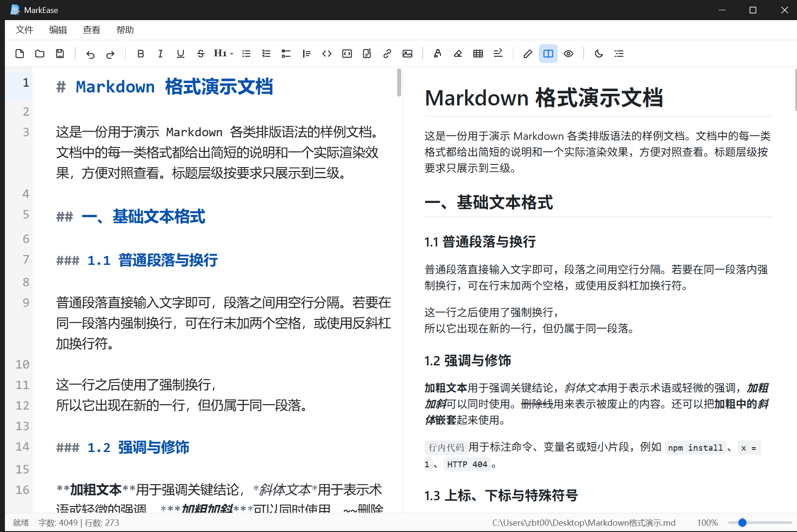
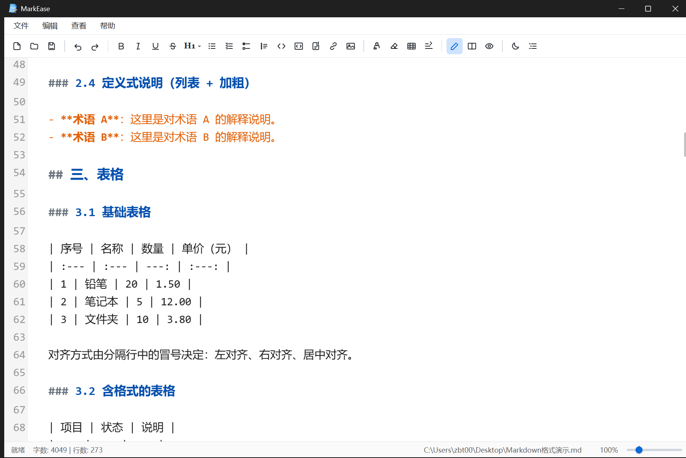
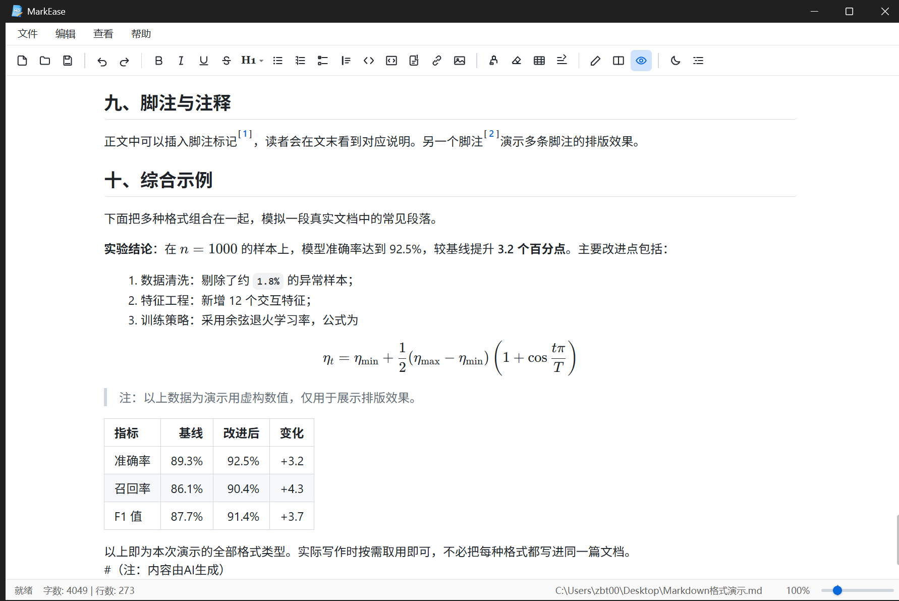
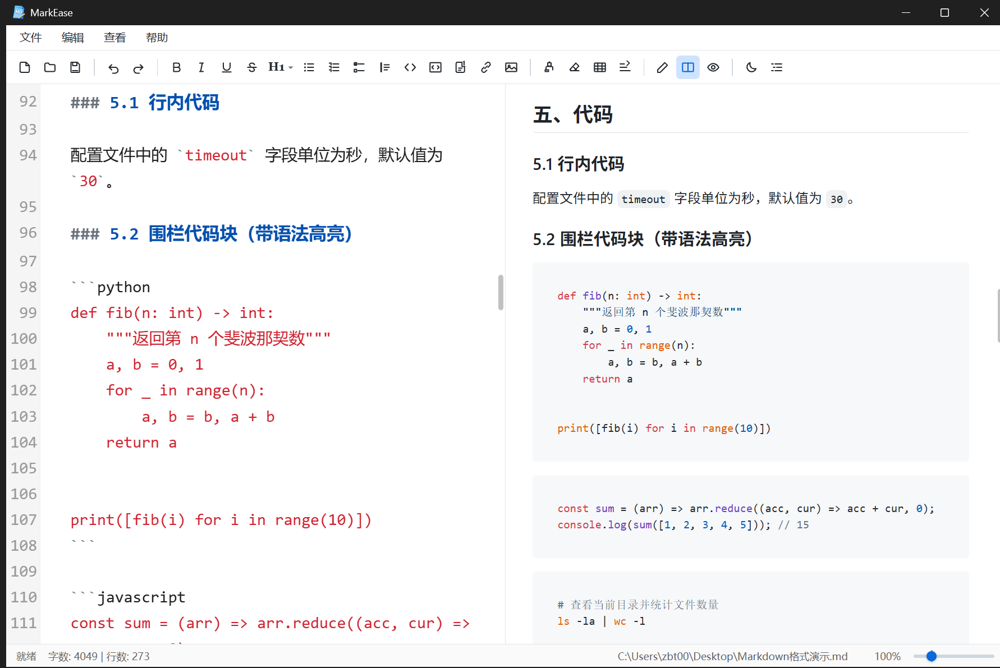
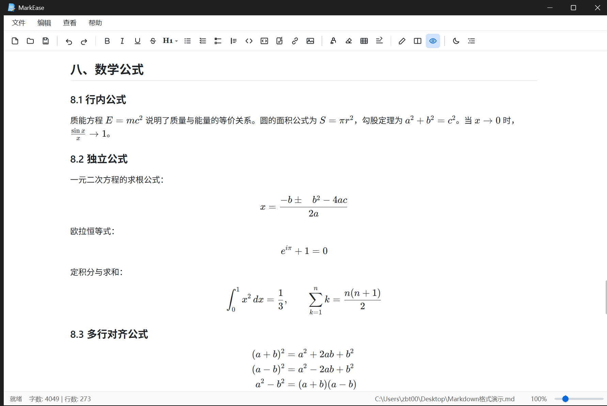
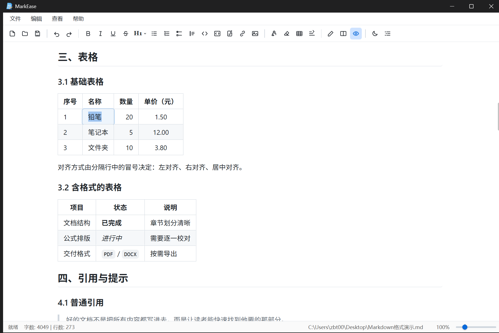
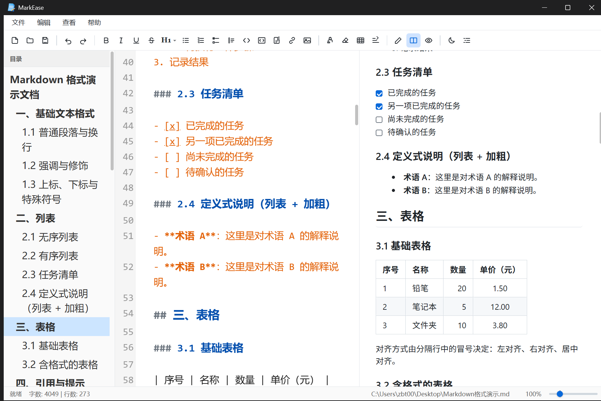
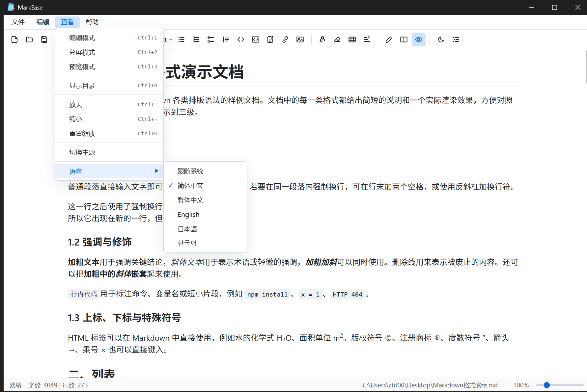

# 📝 MarkEase

> 一款运行于 Windows / macOS / Linux、**完全离线**、GitHub 风格的 Markdown 编辑器

[](https://github.com/zbt00123/MarkEase/releases) [](LICENSE) [](https://github.com/zbt00123/MarkEase/releases)

**中文** | [English](README.md) | [日本語](README_JA.md) | [한국어](README_KO.md)

> ⚠️ **Windows SmartScreen / 杀毒软件提示**
> 发布包目前**尚未进行代码签名**，首次运行时可能看到「Windows 已保护你的电脑」：
> 点击「更多信息 → 仍要运行」即可。
> 本程序使用 WebView2 渲染，启动时已禁用其后台网络与组件更新；如杀毒软件误报，请将 `MarkEase.exe` 添加信任。

> ⚠️ **macOS / Linux 提示**
> macOS 版为 `.dmg`（Intel / Apple Silicon 各一个），当前**未签名、未公证**，首次打开请右键 App →「打开」，或执行 `xattr -dr com.apple.quarantine /Applications/MarkEase.app`。
> Linux 版提供 `.deb` 与 `tar.gz`，需要系统已安装 GTK3 / WebKit2GTK；推荐安装 `.deb`。
> 三个平台共用同一份业务代码，构建方法见 [docs/CROSS_PLATFORM.md](docs/CROSS_PLATFORM.md)。

---

## ✨ 功能亮点

### ⚡ 写作与排版

- **三种模式**：编辑 / 分屏 / 预览，`Ctrl+1` / `Ctrl+2` / `Ctrl+3` 随时切换
- **熟悉的编辑体验**：语法高亮、行号、撤销 / 重做，选中多行还能批量加引用、列表、任务或代码块
- **工具栏一应俱全**：标题、加粗、斜体、下划线、删除线、列表、任务、引用、行内代码、代码块、脚注、链接、图片、表格、折叠块
- **格式刷 / 橡皮擦**：单击刷一次、双击连续刷；橡皮擦一键清除行内格式
- **插入链接**：输入网址后自动获取网页标题，也可以自定义链接文字和网站图标
- **插入表格**：工具栏网格选行列，快速生成标准表格
- **插入图片**：本地选择、拖拽或网络 URL，图片自动收进文档同级的 `assets/` 目录
- **不丢内容**：新建、打开或关闭窗口时如有未保存修改，会先询问是否保存

### 🔢 有序列表自动编号

- 修改某一项编号后，后续同级项自动顺延；插入、删除行时编号也会自动维护
- 自动编号生效时可选择「保持自动 / 转为手动」，不会被意外改回

### 👁️ 预览里直接改

- 双击段落、表格单元格或脚注内容，就能在预览区直接编辑，修改实时写回 Markdown
- 切换模式、保存或查找前会自动提交，不会丢失正在编辑的内容

### 📖 脚注

- 一键插入脚注，正文显示为上标，点击即可跳到文末脚注区
- 脚注末尾的 `↩` 可以跳回引用位置，编辑器中 `Ctrl + 点击 [^N]` 同样有效
- 删掉正文中的脚注引用后，文末对应的定义行会自动清理

### 📑 目录与同步滚动

- 自动解析全文标题生成目录，当前章节滚动高亮，点击后编辑区与预览区同时定位
- 目录宽度可拖动，`Ctrl+B` 随时显示或隐藏
- 编辑区与预览区同步滚动，代码块、表格、引用等行距差异较大的内容也能保持对齐

### ✅ 任务列表

- 预览区点击 checkbox 即可切换完成状态，源码同步更新
- 选中多行后点击任一 checkbox，可批量切换
- 复制出来仍是 `- [x]` / `- [ ]` 原文，粘贴到别处不会丢格式

### 🔎 查找与替换

- `Ctrl+F` 打开浮动查找栏，`Ctrl+H` 直接进入替换
- 默认忽略大小写，可切换为区分大小写
- 支持跨 `**`、`*`、`~~`、反引号等行内标记的模糊匹配
- 预览区同步高亮命中位置，并显示匹配数量
- 查找栏可拖动，不会挡住正在看的内容

### 📊 表格

- 表头与左 / 中 / 右对齐按源码原样呈现
- 预览区双击单元格即可修改，支持加粗、斜体、行内代码等格式

### 🌍 语言与主题

- 简体中文 / 繁體中文 / English / 日本語 / 한국어，切换后立即生效，无需重启
- 浅色 / 深色 / 跟随系统三种主题，编辑区与预览区同步切换

### 🎯 缩放

- 10% – 500% 缩放，编辑区与预览区同步
- 状态栏滑块支持单击吸附，点击百分比可直接选择常用缩放级别

### 📄 PDF

- 导入 PDF 自动转成 Markdown，导出为高清矢量 PDF
- 代码块长行在预览和 PDF 中自动换行，不会被裁掉
- 导出的 PDF 内嵌原始 Markdown，再次导入可无损还原
- 导入时缺失的本地图片会自动从 PDF 中找回

### 🌐 HTML

- 导出时自动内联图片、清理深色样式，并嵌入源 Markdown 与文档目录
- 再次导入可无损还原；第三方 HTML 也能直接转成 Markdown
- 本地图片失效时，会尝试从 HTML 中恢复

### 🖥️ 系统集成

- 可设为 `.md` / `.markdown` 的默认打开程序
- 支持右键「新建 → Markdown 文件」、双击打开、拖拽导入
- 点击状态栏中的文件路径，直接在资源管理器中定位
- 图片重名时弹窗对比，选择替换或两者都保留

### 🛡️ 离线与安全

- 完全离线运行，不收集、不上传任何用户数据
- 打开第三方 HTML 时自动过滤脚本、内联事件与危险标签

---

## 🖼️ 界面预览

> 以下截图由 MarkEase 实际界面截取，示例文档为 Markdown 格式演示。

| 场景 | 截图 |
|:---:|:---:|
| 分屏模式 |  |
| 编辑模式 |  |
| 预览模式 |  |
| 代码块语法高亮 |  |
| 数学公式 |  |
| 表格单元格编辑 |  |
| 任务列表 + 目录 |  |
| 多语言切换 |  |

---

## 🚀 快速开始

### 📦 下载使用

1. 前往 [Releases](https://github.com/zbt00123/MarkEase/releases) 下载最新版本
2. 按平台选择：

   | 平台 | 文件 |
   |---|---|
   | Windows x64 | `MarkEase_v*_Windows_x64_portable.zip` → 解压后双击 `MarkEase.exe` |
   | macOS Intel | `MarkEase_v*_macOS_x64.dmg` |
   | macOS Apple Silicon | `MarkEase_v*_macOS_arm64.dmg` |
   | Linux x64 | `MarkEase_v*_Linux_x64.deb`（推荐）或 `..._Linux_x64.tar.gz` |

3. Windows 首次启动会自动添加右键「新建 → Markdown 文件」项。
   如需设为 `.md` 默认程序：**帮助 → 设置 → 设为默认打开程序**。
4. macOS 首次打开需右键 →「打开」（未签名）；Linux 安装 deb 后直接运行 `markease`。

### 🧑‍💻 从源码运行

```bash
git clone https://github.com/zbt00123/MarkEase.git
cd MarkEase
pip install -r requirements.txt
python main.py
```

> 建议使用 Python 3.11+；Windows 需要 WebView2 运行时（Windows 10/11 通常已内置）。

### 🛠️ 从源码构建

```bash
pip install pyinstaller
python -m PyInstaller --clean --noconfirm MarkEase.spec
```

macOS / Linux 的构建与打包命令见 [docs/CROSS_PLATFORM.md](docs/CROSS_PLATFORM.md)。

---

## ⌨️ 快捷键一览

| 功能 | 快捷键 |
|---|---|
| 新建 / 打开 / 保存 / 另存为 | `Ctrl+N` / `Ctrl+O` / `Ctrl+S` / `Ctrl+Shift+S` |
| 撤销 / 重做 | `Ctrl+Z` / `Ctrl+Y` |
| 编辑 / 分屏 / 预览模式 | `Ctrl+1` / `Ctrl+2` / `Ctrl+3` |
| 显示 / 隐藏目录 | `Ctrl+B` |
| 放大 / 缩小 / 重置缩放 | `Ctrl+=` / `Ctrl+-` / `Ctrl+0` |
| 插入图片 | `Ctrl+Shift+I` |
| 查找 / 替换 | `Ctrl+F` / `Ctrl+H` |
| 退出 | `Ctrl+Q` |
| 跳转脚注定义 / 回到引用 | `Ctrl + 点击 [^N]` |

> macOS 上 `Ctrl` 对应 `⌘`（Command），界面会按平台自动显示。

---

## 🔐 隐私

MarkEase 不收集、不上传任何用户数据，也没有遥测与账号体系。仅在以下情况下访问网络：

- 当你主动插入 / 打开网络图片时，程序会通过内置 `/proxy` 按该图片 URL 下载；
- 当你主动使用「插入链接 → 自动获取标题」时，会抓取目标网页标题；
- 每 30 天向 GitHub Releases 检查一次更新（仅一次 HTTPS 请求，不含任何个人信息），
  也可通过「帮助 → 检查更新」手动触发；检测时会绕过系统代理，避免 VPN 干扰。

---

## 📄 许可证

本项目基于 [MIT License](LICENSE) 发布，Copyright (c) 2026 zbt00123。

- **你可以**：自由使用、复制、修改、合并、发布、分发、再许可和/或销售本软件的副本，
  也可用于商业项目。
- **唯一要求**：在软件的所有副本或重要部分中，保留上述版权声明与本许可声明。
- **免责**：本软件按「原样」提供，不附带任何明示或暗示的担保。

第三方组件按各自许可证发布，详见 [THIRD_PARTY_NOTICES.md](THIRD_PARTY_NOTICES.md)。

> **注意**：PDF 功能使用 **PyMuPDF**（**AGPL-3.0** 或 Artifex 商业许可），
> 完整组件清单与合规说明见 [THIRD_PARTY_NOTICES.md](THIRD_PARTY_NOTICES.md)。

---

## 🙏 致谢

- [pywebview](https://pywebview.flowrl.com/) — 轻量级 Python WebView 封装
- [CodeMirror 6](https://codemirror.net/) — 现代化编辑器内核
- [marked](https://marked.js.org/) — Markdown 解析
- [KaTeX](https://katex.org/) — 数学公式渲染
- [highlight.js](https://highlightjs.org/) — 代码高亮
- [PyMuPDF](https://pymupdf.readthedocs.io/) — PDF 解析与生成
